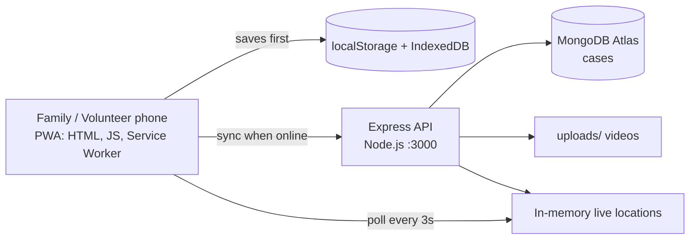

# Architecture

## Overview
Rakshak is an offline-first web app (PWA) with a small Node.js and MongoDB backend. The device is the source of truth while offline; the server is the shared place where all volunteers, medical teams and authorities see the same cases.

## Components
| Component | File | Role |
|---|---|---|
| UI and logic | `index.html`, `app.js`, `style.css` | Tabs: Register, Volunteer, Emergency |
| Offline support | `sw.js`, `manifest.json` | Network-first caching, installable PWA |
| Local storage | localStorage, IndexedDB | people, cases, SMS log; emergency videos |
| API | `server/server.js` | Express REST API |
| Database | MongoDB Atlas (Mongoose) | `rakshak.cases` collection |

## Offline strategy (store and forward)
1. Every new case is saved on the device with `synced: false`.
2. When online, `syncAll()` checks `/api/health`, uploads any pending video, then POSTs each unsynced case.
3. The server uses an **upsert** on the case id, so a repeated sync never creates duplicates.
4. Every 15 seconds the app syncs pending items and pulls new cases from the server (`pullAlerts`).

## Data model (`cases`)
| Field | Type | Notes |
|---|---|---|
| cid | string | unique case id (client generated) |
| type | string | `missing`, `found` or `medical` |
| personId, name, age, desc, place, time | string / number | case details |
| status | string | `open`, `matched`, `alerted`, `responding` |
| lat, lng, acc | number | emergency location |
| photo | string | small thumbnail (data URL) |
| video | string | file name inside `server/uploads/` |
| phone | string | family phone, stored but **never returned by the API** |

## API
| Method | Path | Purpose |
|---|---|---|
| GET | `/api/health` | server and database status |
| GET | `/api/cases` | latest 150 cases (without phone numbers) |
| POST | `/api/cases` | create or update a case (upsert) |
| POST | `/api/media/:id?ext=mp4` | upload an emergency video (raw body, max 40 MB) |
| POST | `/api/live` | share live location `{caseId, kind: patient or team, lat, lng}` |
| GET | `/api/live?caseId=...` | latest patient and team locations |

## Matching
Text from the description and name is tokenised, Hindi words are mapped to English (for example "lal" to red, "kurta" to kurta), and a score is built from common words, nearby age and an exact name match. A volunteer always confirms before a family is alerted.

## Privacy
- Only the minimum data is stored (name, age, description, phone, optional photo).
- Phone numbers are not exposed by `GET /api/cases`.
- Live locations are kept in memory only and are lost on server restart.

## Known limitations and future work
- No login or roles; planned separate logins for volunteer, police, medical team and admin.
- SMS is simulated; planned integration with an SMS gateway.
- Crowd density is simulated; planned camera analysis (OpenCV).
- Live tracking needs network; offline alerts are queued.
- Hindi voice recognition in Chrome uses an online speech service.
